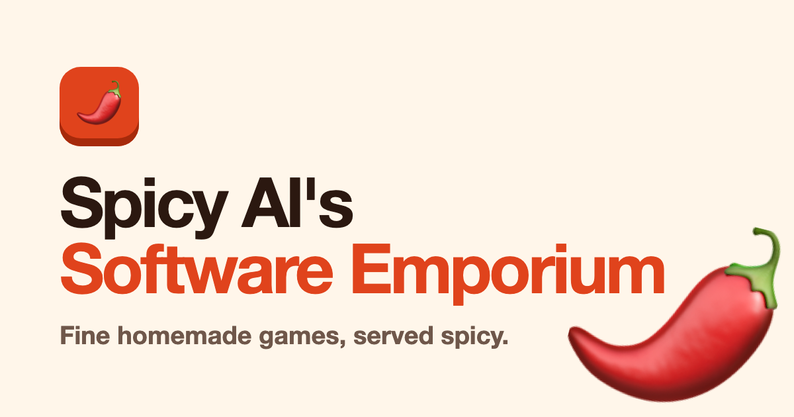
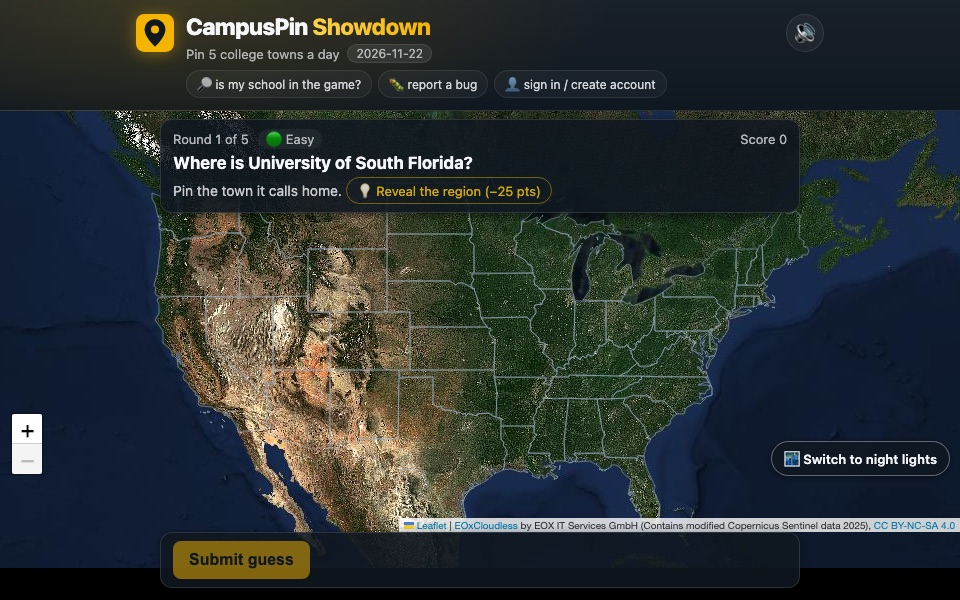
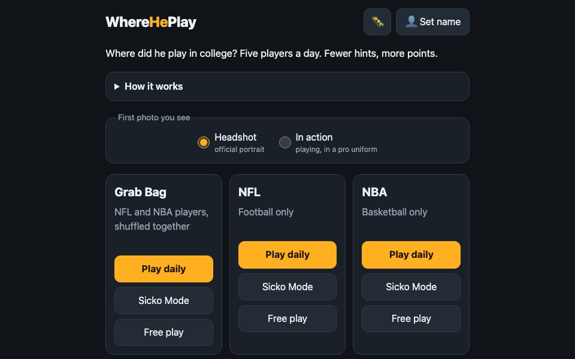
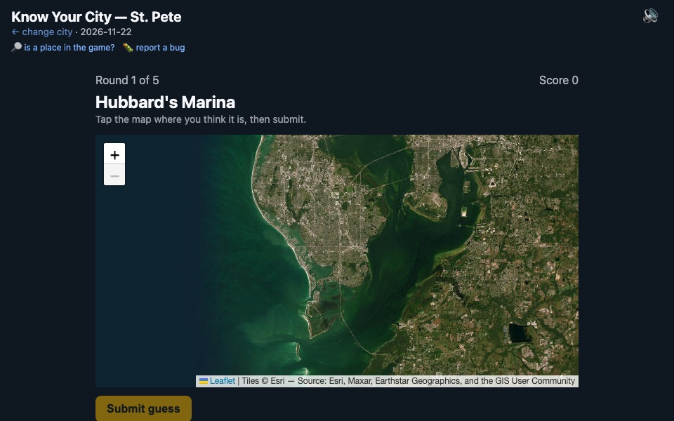
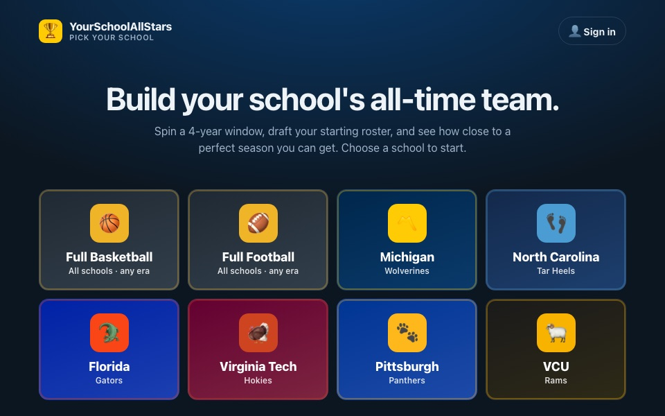
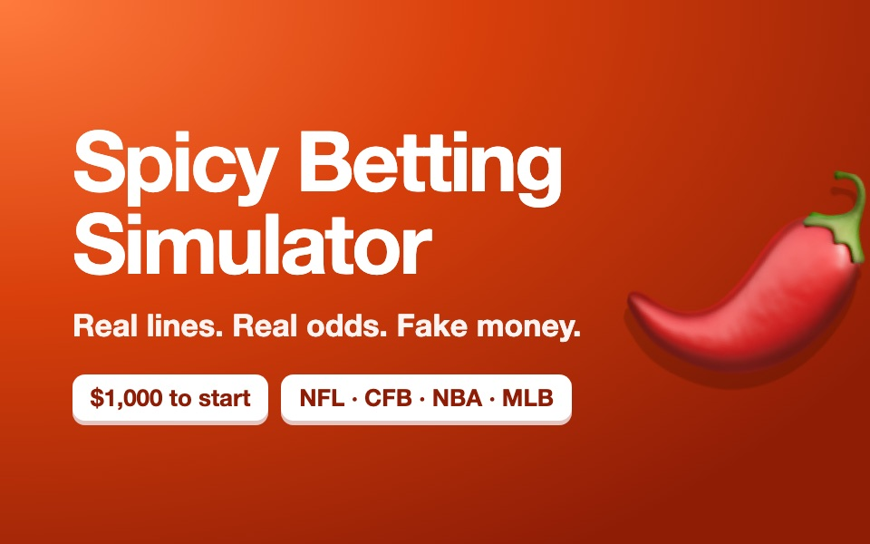

<div align="center">

# 🌶️ Spicy Al's Software Emporium

**Fine homemade games, served spicy.**

One page that points at every game Spicy Al has made, plus the other projects.

### ▶ [spicyalssoftwareemporium.com](https://spicyalssoftwareemporium.com/)

[](https://github.com/wardcrazy01894/SpicyAlsSoftwareEmporium/actions/workflows/ci.yml)
[](https://github.com/wardcrazy01894/SpicyAlsSoftwareEmporium/actions/workflows/deploy.yml)


[](https://spicyalssoftwareemporium.com/)

</div>

## 🎮 The games

Five games you can play right now in your browser, mostly about sports and maps,
all free with no ads. Four have a new puzzle every day.

|                                                                                                                              | Game                                                                                                                                                                                              | What it is                                                                                                                                                    |
| :--------------------------------------------------------------------------------------------------------------------------: | ------------------------------------------------------------------------------------------------------------------------------------------------------------------------------------------------- | ------------------------------------------------------------------------------------------------------------------------------------------------------------- |
|             [](https://campuspinshowdown.com/)              | **[CampusPin Showdown](https://campuspinshowdown.com/)**<br>Geography · daily<br>[source](https://github.com/wardcrazy01894/CampusPinShowdown)                                                    | Where is Texas Tech? Drop a pin on a satellite map of the USA for five schools a day, then find out which college town you were actually looking for.         |
|                    [](https://whereheplay.com/)                    | **[WhereHePlay](https://whereheplay.com/)**<br>Sports trivia · daily<br>[source](https://github.com/wardcrazy01894/WhereHePlay)                                                                   | You get a photo of an NFL or NBA player. Name the college he played for. Tom Brady is a gimme; the backup tight end is not. Fewer hints, more points.         |
|                  [](https://knowyourcity.gg/)                   | **[Know Your City](https://knowyourcity.gg/)**<br>Geography · daily<br>[source](https://github.com/wardcrazy01894/KnowYourCity)                                                                   | Pick a city and get five local spots a day: landmarks, bars, restaurants. Drop a pin on the satellite map and see how well you really know your town.         |
| [](https://wardcrazy01894.github.io/YourSchoolAllStars/) | **[YourSchoolAllStars](https://wardcrazy01894.github.io/YourSchoolAllStars/)**<br>Sports draft · daily<br>[source](https://github.com/wardcrazy01894/YourSchoolAllStars)                          | Spin a four-year window of your school's history and draft one player per round into an all-time lineup. Build it well enough and you go 40–0.                |
|  [](https://spicybetting.wardcrazy01894.workers.dev/)  | **[Spicy Betting Simulator](https://spicybetting.wardcrazy01894.workers.dev/)**<br>Sportsbook, minus the money · invite only<br>[source](https://github.com/wardcrazy01894/SpicyBettingSimulator) | Real lines, real odds, fake money. Start with $1,000, bet this week's games at the prices the books are posting, and let the leaderboard settle the argument. |

## 🧰 The second shelf

|     | Project                                                                                                                                                     | What it does                                                                                                                         |
| :-: | ----------------------------------------------------------------------------------------------------------------------------------------------------------- | ------------------------------------------------------------------------------------------------------------------------------------ |
| 🎲  | **[Random YouTube](https://wardcrazy01894.github.io/RandomYoutubeLinkGenerator/)** · [source](https://github.com/wardcrazy01894/RandomYoutubeLinkGenerator) | One button, one genuinely random YouTube video. A uniform draw, so it is mostly home videos with a few dozen views.                  |
| ⛳  | **[TeeTimeBooker](https://spicyteetimebooker.com)** · [source](https://github.com/wardcrazy01894/TeeTimeBooker)                                             | Pick your courses and time windows, and a bot books the tee time for the whole group the second the slots drop. Invite only.         |
| 🏷️  | **[SpicyDiscountSearcher](https://github.com/wardcrazy01894/SpicyDiscountSearcher)**                                                                        | A Chrome and Brave extension that races corporate discount codes against each other to find the cheapest rental car or hotel rate.   |
| 🏀  | **[82And0](https://github.com/wardcrazy01894/82And0)**                                                                                                      | Spin automation and analysis for 82-0.com: chasing the perfect 82–0 season, and the maybe-impossible 0–82.                           |
| 🔎  | **[LocalBusinessScanner](https://github.com/wardcrazy01894/LocalBusinessScanner)**                                                                          | Scans local businesses for web design leads: checks whether each one has a website and scores how good it is.                        |
| 🎧  | **[SpotifyLocalMigrator](https://github.com/wardcrazy01894/SpotifyLocalMigrator)**                                                                          | Rebuilds decade-old "local files" playlists as real streaming playlists, with strict matching and every mismatch flagged for review. |

## 🏗️ How it's built

A plain static site: no framework and no build step. `site/` is uploaded to
GitHub Pages exactly as it is, and the page is complete without JavaScript.

```
site/
  index.html    the page — every game and project is a block of HTML here
  styles.css    design tokens (light + dark) and layout
  app.js        theme toggle, "Surprise me", per-browser "played today" badges
  covers/       960×600 JPEG card covers (16:10)
  og-image.png  1200×630 share image
  favicon.svg
tests/          structural guards (node --test, no dependencies)
scripts/        protect-main.sh (repo settings), set-domain.sh (domain cutover)
docs/OPERATIONS.md   deploy, custom-domain cutover, repo settings
```

## 🚀 Run it

```bash
npm install     # prettier + html-validate, dev only
npm run dev     # http://localhost:8000
```

Before opening a PR — this is exactly what CI gates on:

```bash
npm run lint && npm run format:check && npm test
```

## ➕ Add a game

1. Copy one `<article class="game-card">` block in `site/index.html` and edit
   the links, text and chips. `--c` is the card's accent colour; `data-slug`
   must be unique; keep `data-daily` only if the game has a new puzzle every day
   (it drives the "played today" badge and the tally).
2. Add a 960×600 cover to `site/covers/`. The existing ones are headless-Chrome
   screenshots of the live sites:

   ```bash
   "/Applications/Google Chrome.app/Contents/MacOS/Google Chrome" --headless=new \
     --hide-scrollbars --window-size=960,600 --virtual-time-budget=15000 \
     --screenshot=shot.png https://example.com/
   sips -s format jpeg -s formatOptions 82 shot.png --out site/covers/<slug>.jpg
   ```

3. Update the count in the hero text and the "4 with a new puzzle every day"
   note (a test checks the second one against the cards).
4. Add its row to the games table in this README.

Other projects are `<li class="project">` rows in the same file.

## 🌐 Deploys and the domain

Every merge to `main` publishes automatically. The site uses only relative
URLs, so moving to a custom domain is one command plus some DNS:

```bash
bash scripts/set-domain.sh example.com
```

The full cutover is in [`docs/OPERATIONS.md`](docs/OPERATIONS.md#custom-domain).

---

<div align="center">

A Spicy Al Software Solution

</div>
